# reolink-esp32-chime

An ESP32 + CC1101 wireless chime for **Reolink Chime hardware V2**. Pair it in
the Reolink app, then use a passive buzzer, an existing low-voltage gong through
a relay, or silent MQTT events. The doorbell communicates directly with the
CC1101; WiFi provides setup, control, updates and Home Assistant integration.

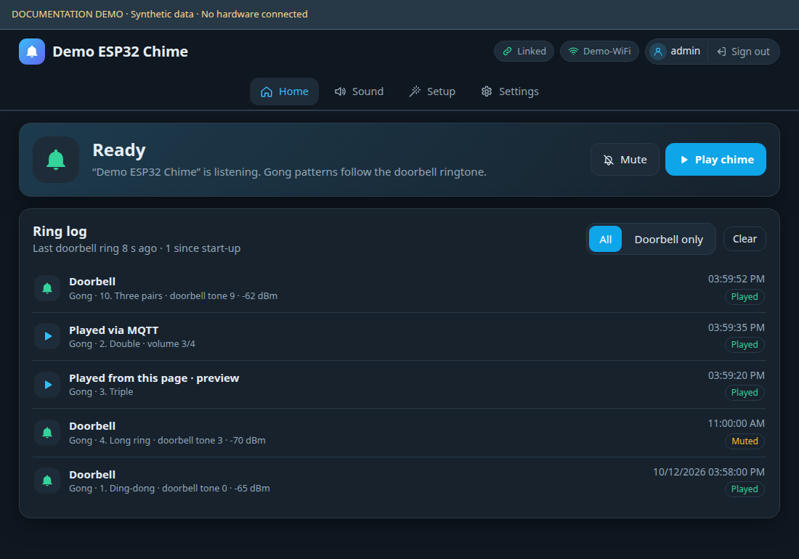

The screenshots render the firmware's embedded UI with **synthetic demonstration
data**. They do not show a live device. All images are included locally.

## Compatibility and features

The tested configuration is an ESP32-WROOM-32 and 868 MHz CC1101 with a Reolink
WiFi Video Doorbell, model **DB_566128M5MP_W**. Hardware V2 pairing, encrypted
join, reboot rejoin, physical doorbell presses, the main Reolink chime Test
control, name/volume/LED settings and OTA have been validated on that setup.
Other doorbell models, other chime hardware revisions and the 915/920 MHz
presets have not been validated. Audible buzzer output and physical relay
timing still need hardware verification.

- Normal Reolink pairing with an individual AES key; saved credentials and automatic rejoin.
- Three buzzer melodies: Ding dong, Ascending and Double beep.
- Five relay patterns: Ding-dong, Double, Triple, Long ring and Insistent.
- Silent mode, permanent/timed mute, optional extra relay pulse and configurable LED.
- Mobile-friendly web UI, light/dark/system theme and optional sign-in.
- 2.4 GHz WiFi onboarding, standalone access point and WiFi-off operation.
- MQTT commands, events, retained state and 21 Home Assistant discovery entities.
- Last 50 ring events persisted locally, RF packet history and downloadable text diagnostics.
- Configurable GPIOs, automatic frequency trim, two RF receivers and web OTA.
- PlatformIO build, portable host tests and protocol fuzzing tools.

The ESP32 plays local PWM melodies/patterns. Reolink's sampled ringtone library
is not included; its ringtone number is recorded with received events.

## Documentation

| Document | Contents |
|---|---|
| [PROTOCOL.md](PROTOCOL.md) | V2 RF framing, pairing, encryption, join, data and frequencies |
| [API.md](API.md) | HTTP routes, authentication, request fields, responses and MQTT |
| [WIRING.md](firmware/WIRING.md) | Radio, passive buzzer, relay circuits and physical controls |
| [Firmware developer guide](firmware/README.md) | Build, source modules, tests, versioning and packaging |
| [Image documentation](firmware/docs/README.md) | Hardware reference sources and screenshot reproduction |

## Hardware

| Part | Requirements |
|---|---|
| ESP32 board | ESP32-WROOM-32 development board, `esp32dev`, 4 MB flash; reference image is a 38-pin board |
| Radio | CC1101 module with a 26 MHz crystal and matching 868 MHz RF network/antenna for the tested configuration |
| Power | USB supply for the ESP32; radio power and signals are **3.3 V** |
| Radio decoupling | 100 nF ceramic and 10 µF across VCC/GND near the module |
| CS bias | Recommended 10 kΩ pull-up from CSN to 3V3 |
| Optional sound | Passive buzzer/transducer with a suitable MOSFET driver, or a 3.3 V compatible relay interface |
| Optional driver parts | 100 Ω gate resistor, 100 kΩ gate pull-down and flyback diode for inductive loads |

Use a module and antenna matched to the chosen band. A 433 MHz ASK/OOK receiver
cannot implement this bidirectional GFSK protocol. GPIO16/17 are used by PSRAM
on some WROVER boards, so the default map targets WROOM.

### Wiring and reference images

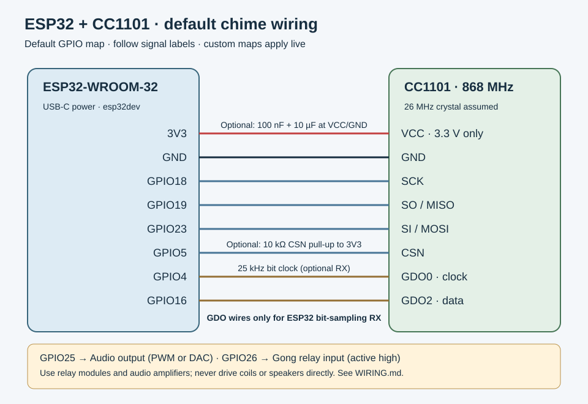

| CC1101 signal | ESP32 GPIO / supply | Notes |
|---|---|---|
| VCC | 3V3 | Never connect to 5 V |
| GND | GND | Common low-voltage ground |
| SCK | GPIO18 | SPI clock |
| SO / MISO | GPIO19 | SPI input / chip ready |
| SI / MOSI | GPIO23 | SPI output |
| CSN | GPIO5 | Chip select; pull-up recommended |
| GDO0 | GPIO4 | Clock for optional ESP32 bit-sampling RX |
| GDO2 | GPIO16 | Data for optional ESP32 bit-sampling RX |
| Passive buzzer driver | GPIO25 | MOSFET gate, never a coil/speaker directly |
| Relay driver/input | GPIO26 | Active high by default; active low configurable |
| Status LED | GPIO2 | Board LED presence/polarity varies |
| Local button | GPIO0 | BOOT button after startup |

The default **CC1101 packet-engine receiver needs power and the four SPI
signals**; GDO0/GDO2 can remain connected but are only required for ESP32
bit-sampling mode. Follow signal labels rather than header position.

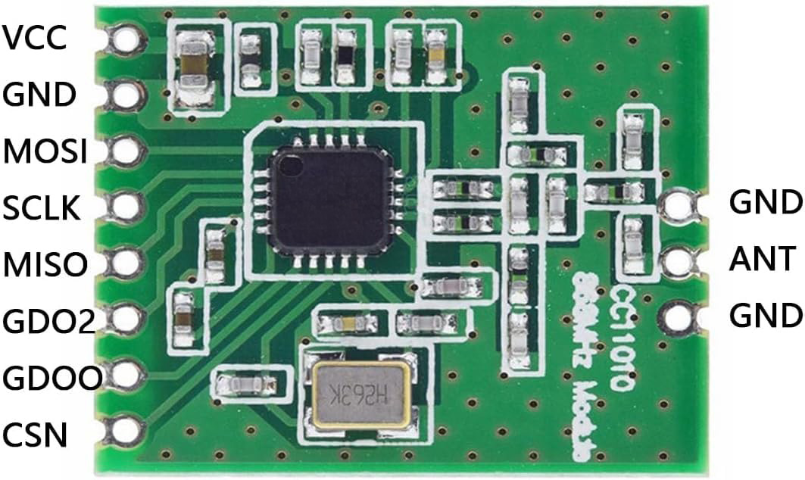

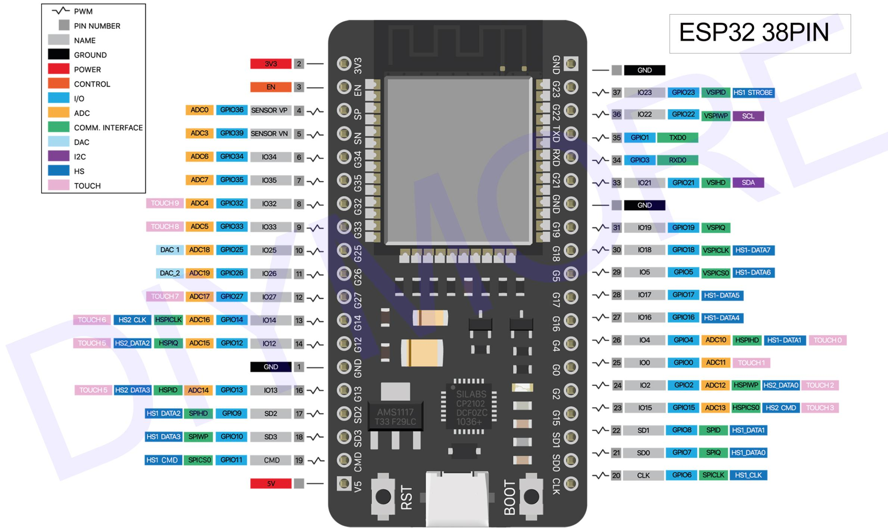

The references show the component side and are not photographs of the assembled
project. Source links are in [image documentation](firmware/docs/README.md).

For a buzzer, connect its positive lead to its rated supply and switch its
negative lead with a MOSFET that conducts at a 3.3 V gate voltage. Join grounds;
put a flyback diode across an inductive buzzer, cathode to the positive supply.
Use a passive device to play multiple pitches. DAC audio and I2S are not implemented.

For an existing gong, connect the relay's **COM and NO dry contacts** across the
gong's low-voltage pushbutton terminals. The gong circuit stays on the relay
contact side. Some active-low optocoupler boards require removing the `JD-VCC`
jumper, supplying the coils from 5 V and the input side from 3V3. Follow the
module-specific circuit in [WIRING.md](firmware/WIRING.md).

## Build and first installation

Install PlatformIO Core or the PlatformIO IDE extension. The project pins
`espressif32@6.9.0` and `ArduinoJson@6.21.5`; the ESP32 platform uses Arduino
core 2.0.17. From the repository folder:

```bash
cd firmware
pio device list
pio run
pio run --target upload --upload-port /dev/ttyUSB0
pio device monitor --port /dev/ttyUSB0 --baud 115200
```

Replace the port with your board's port. If automatic upload fails, hold BOOT
while connecting and release when writing starts. Initial USB upload installs
the bootloader, partition table and app. A standalone OTA app `.bin` does not
install a blank board.

## WiFi setup

1. Power up. A new device exposes the open hotspot **Reolink-Chime-xxxxxx** with sign-in disabled.
2. Join the hotspot and open **http://192.168.4.1/** manually.
3. In Setup, scan for a **2.4 GHz** WiFi network, enter its password and connect.
4. On your LAN, open **http://reolink-chime.local/** or the device IP shown in the UI/serial log.
5. Optionally enable sign-in in Settings → Sign-in and set a username/password.

WiFi connection starts immediately without a reboot. A failed or lost client
connection opens the setup hotspot after 20 seconds; an opened hotspot remains
until reboot. The RF chime continues independently of WiFi.

| WiFi mode | Behavior after restart |
|---|---|
| Client | Join saved WiFi; enable fallback setup hotspot when needed |
| Access point | Run only the chime's hotspot at 192.168.4.1; configurable SSID/password; MQTT/SNTP stay idle |
| Off | Disable WiFi and HTTP; paired RF ringing continues |

An empty custom AP password falls back to the sign-in password while sign-in is
enabled, otherwise an open hotspot. AP passwords are 8–63 characters. Mode and
AP changes require restart; Setup → Connect switches back to client mode.

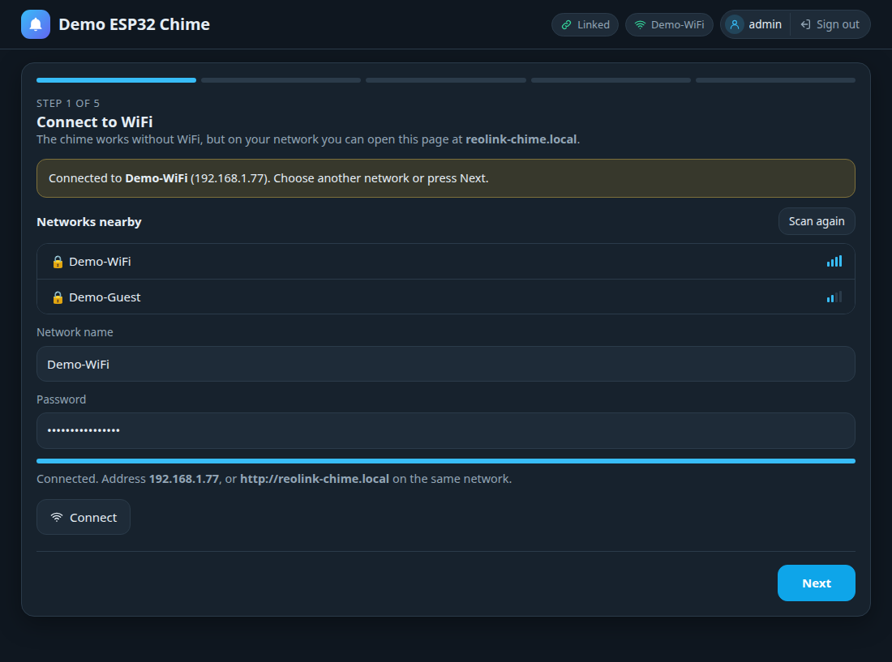

## Pairing with the doorbell

1. Keep the default **868.000 MHz** for the tested EU setup; select another carrier only if your doorbell uses it.
2. Open your doorbell's chime settings in Reolink and start its normal add-chime search.
3. In the ESP32 web UI, open Setup and choose **Start pairing**.
4. Select the discovered chime in Reolink and complete pairing within five minutes.
5. Confirm the ESP32 reports Joined, then press the physical doorbell and check the Home ring log.
6. Set the name, volume and LED in Reolink or the ESP32 UI; choose local output settings in Sound.

Pairing learns the doorbell ID and a fresh 16-byte AES key, echoes the key and
completes an encrypted join. Credentials persist only after successful final
ACK transmission. Reboot or a doorbell disconnect request triggers rejoin.
Joined is a local state; a physical press verifies that the doorbell accepted
the exchange. Repeated RF ring transmissions produce one local event.

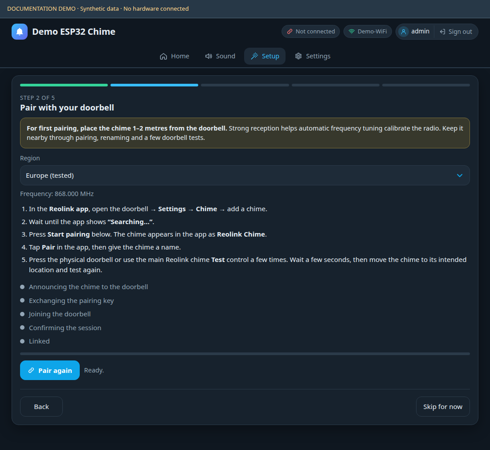

New node IDs use `1..0x7FFFFFFF`. If an older identity is marked incompatible,
remove its chime entry in Reolink and start pairing to replace it. Canceling a
handshake preserves the previously saved profile. If the doorbell already
accepted a replacement key, repeat pairing to reconcile the two devices.

The main Reolink chime Test/play control was observed to send RF. Ringtone-list
preview icons did not send RF in the tested setup; use the main control or a
physical press when verifying reception.

## Web interface

| Area | Controls |
|---|---|
| Home | Readiness, WiFi/link state, Mute, Play chime, filtered ring history and clear |
| Sound | Buzzer / existing gong / None, melody or strike pattern, PWM level, app volume, extra relay and LED |
| Setup | WiFi, pairing, name/sound and completion steps |
| Settings → General | Name and per-browser System/Light/Dark theme |
| Network & time | Client/AP/off mode, hotspot settings and NTP server |
| Doorbell | Pairing and saved doorbell information |
| MQTT (Home Assistant) | Broker, credentials, topics, discovery and connection status |
| Sign-in | Optional authentication, credentials and sign-out controls |
| Firmware | OTA app upload and restart |
| Advanced | Frequency, trim, receiver, polarity and GPIO mapping |
| Debug | Radio diagnostics, log/download, last 32 packets, pairing/rejoin/test and passive manual profile |

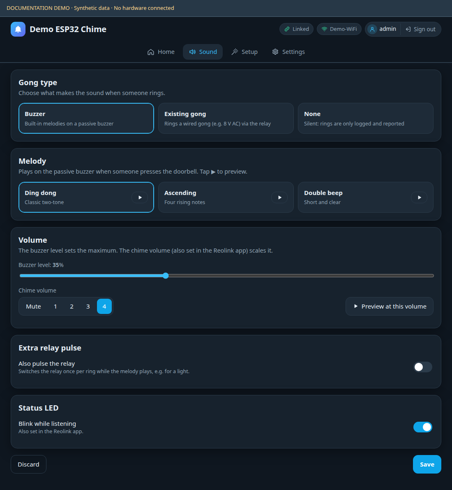

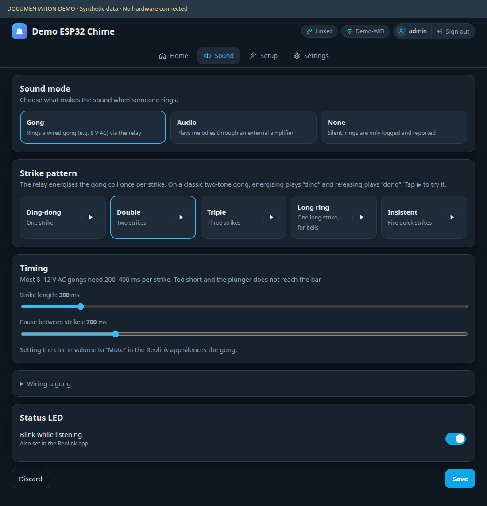

App volume is **0–4**; buzzer PWM level is **0–100%**. Incoming buzzer level
is scaled by app volume. Relay rings are suppressed at app volume zero. Strike
length is 50–2000 ms; gap is 100–3000 ms (defaults 300/700 ms). Long ring uses
four times the strike length, capped at 3000 ms. Insistent produces five strikes
using half pulse/gap with minimums of 50/100 ms. None accepts/logs/publishes rings
without sound. An extra relay pulse in buzzer mode is independent of PWM volume.

Permanent mute survives reboot. Timed mute is 1–1440 minutes and ends on restart.
Muted and silent doorbell rings are still counted and logged. Local web/button/
serial tests bypass owner mute and use full app volume; MQTT play obeys mute
unless `force:true` is supplied.

GPIO saves apply after restart. Optional buzzer/relay/LED/button can be disabled;
the six radio signal assignments must remain valid. Validation identifies
duplicates, flash/UART pins, input-only outputs and boot strap constraints.

Sign-in uses a session cookie or HTTP Basic credentials for scripts. Mutating
API calls use a CSRF token from `/api/status`. Passwords and AES keys are not
returned by settings endpoints. HTTP and MQTT use plain local-network
connections; credentials are stored in ordinary ESP32 NVS.

The UI adapts to phone screens with bottom navigation. Debug provides text
logs, packet history and receiver counters; packet tables may scroll sideways
within their panel.

<details>
<summary>Mobile UI and Debug screenshots</summary>

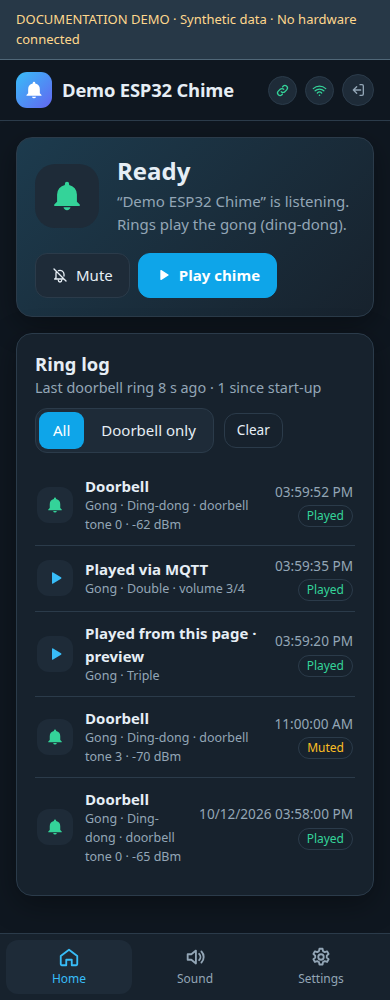

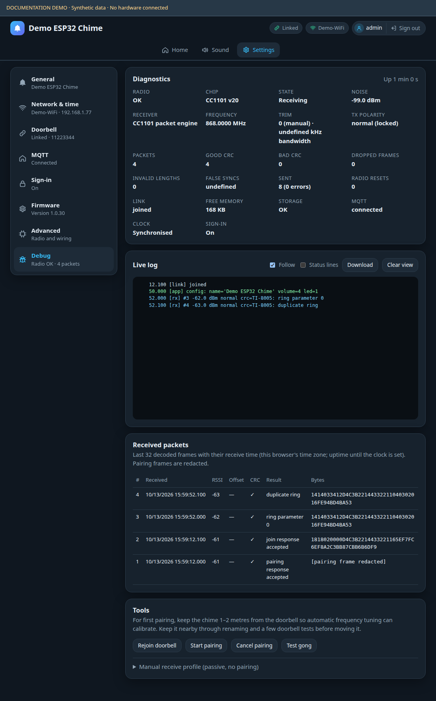

</details>

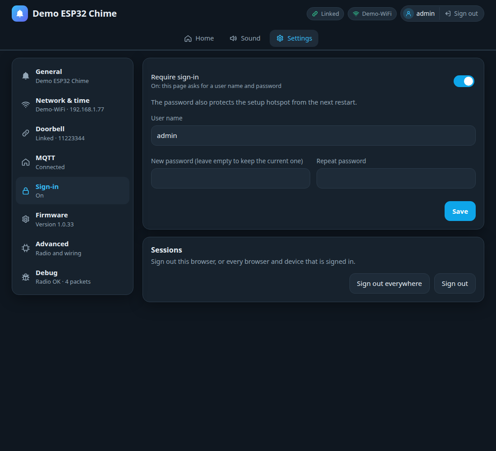

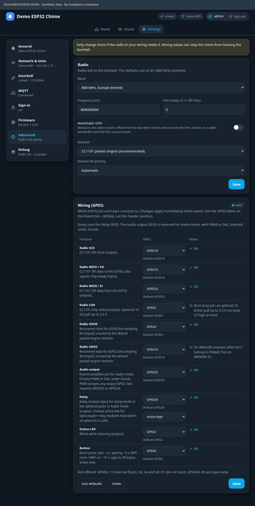

## Frequencies and RF tuning

| Preset | Firmware frequency range | Hardware validation |
|---|---|---|
| 868 MHz | 863–870 MHz | Tested at 868.000 MHz |
| 915 MHz | 902–928 MHz | Untested |
| 920 MHz | 902–928 MHz | Untested |

The link uses 25 kbit/s GFSK, 15 kHz deviation, sync `930B51DE`, PN9 whitening,
CRC-16/0x8005 and AES-128 CTR. See [PROTOCOL.md](PROTOCOL.md) for exact bytes.
The available ranges are firmware validation limits, not evidence that a
doorbell operates on every frequency within them or that every setting is
permitted in every region.

Packet-engine reception is the default. It combines CC1101 FIFO reception with
software sync-tail, whitening and CRC handling. Optional ESP32 bit sampling
needs both GDO wires and cannot measure frequency offset. Automatic trim uses
valid packets from the configured doorbell, a five-sample median and a wider
162.5 kHz acquisition bandwidth; calibrated reception uses 81.25 kHz. Manual
trim is −128..127 at approximately 1.587 kHz per step. Auto trim can overwrite
a manual value; disable it when tuning manually.

## MQTT and Home Assistant

In Settings → MQTT, enable MQTT and enter the broker host/port (default 1883),
optional credentials, base topic and discovery options. Connect the ESP32 in
client WiFi mode. The default base is `reolink_chime/<device-id>`; read its actual
value from `/api/integrations`. The discovery prefix defaults to `homeassistant`.

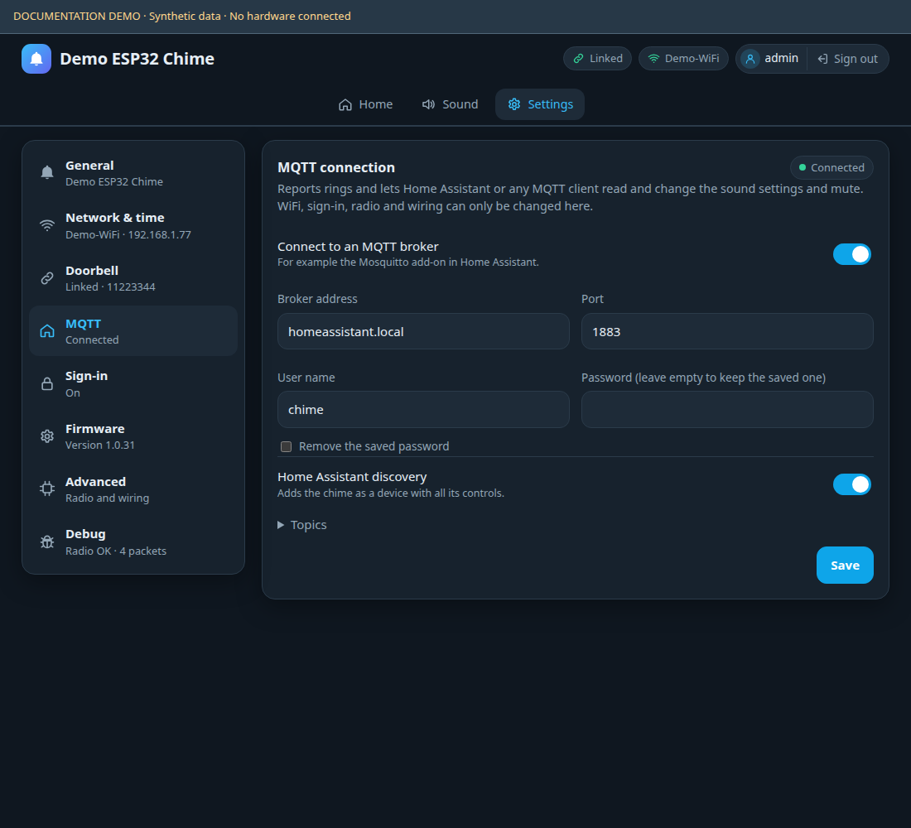

| Topic suffix | Use |
|---|---|
| `/availability` | Retained online/offline and last will |
| `/state`, `/status` | Retained settings and diagnostics |
| `/event` | One ring/test JSON event with source and outcome |
| `/doorbell` | `ON` for a received doorbell event |
| `/set` | Partial JSON settings update |
| `/set/<key>` | Bare value for a single setting |
| `/play` | Play now, with optional temporary overrides |
| `/get` | Republish state/status |
| `/result` | Command acceptance/error |

Examples, substituting the actual base topic:

```bash
mosquitto_sub -h broker.local -t 'reolink_chime/example/#' -v
mosquitto_pub -h broker.local -t 'reolink_chime/example/set' -m '{"volume":2,"melody":"Ascending"}'
mosquitto_pub -h broker.local -t 'reolink_chime/example/set/led' -m OFF
mosquitto_pub -h broker.local -t 'reolink_chime/example/play' -m '{}'
```

Home Assistant discovery adds doorbell events, a five-second Ringing sensor,
Play button, mute controls, output/melody/pattern selects, volume/timing controls,
name/LED controls and link/ring/WiFi diagnostics. MQTT only changes chime settings;
administrative WiFi, RF, GPIO, pairing and OTA operations use the HTTP API.
Events are not buffered for later delivery while the broker is disconnected.
The [API reference](API.md#mqtt-api) describes payloads and all command fields.

## Firmware updates

From `firmware/`, build and create the OTA package:

```bash
pio run
python3 tools/package.py
```

This generates `dist/firmware.bin` and a version/hash manifest. Open Settings →
Firmware and upload the **app-only** `.bin`. RX/playback pause during writing;
the device restarts and the UI waits for it to return. Failed uploads resume
operation and rejoin. Use USB for recovery from an interrupted update.

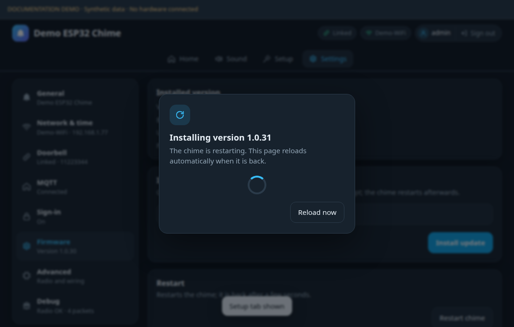

Set the firmware version manually in `firmware/version.json`; builds keep it
unchanged. Push a tag exactly matching that version (e.g. `1.0.24`, without a
`v` prefix) to build, test and publish a GitHub release containing the OTA image
and manifest. A mismatched tag fails the workflow. See the
[release instructions](firmware/README.md#github-releases).

Credentials, pairing and GPIO settings persist across normal updates. Build
caches and generated packages are excluded from Git. Do not upload a bootloader,
partition table or merged image through the web updater.

## Physical controls and recovery

| Action after startup | Result |
|---|---|
| BOOT release after 30 ms–2 s | Test saved local sound |
| BOOT release after 2–8 s | Start pairing for five minutes |
| BOOT hold ≥8 s in client mode | Forget WiFi and open setup hotspot |
| BOOT hold ≥8 s in AP/off mode | Return to client mode, keep saved WiFi and open setup hotspot |
| BOOT hold ≥15 s | Also disable web sign-in and reopen hotspot without password |
| Serial `p` / `c` / `g` | Pair / cancel handshake / local test |
| Serial `w` / `a` | Return to client WiFi with hotspot / disable sign-in |

The table assumes GPIO0 as button. Holding BOOT during reset enters the ROM
flasher. GPIO2 is the default status LED; it blinks when healthy/enabled and
is steady during playback.

## Troubleshooting and development

| Symptom | Check |
|---|---|
| Radio unavailable | 3.3 V power, common ground, SPI labels, CS pull-up and module crystal |
| Pairing fails | Correct carrier, antenna, add-chime search, radio/storage state and Debug log |
| Joined but physical presses do not arrive | Remove an incompatible ID entry, pair again and check session/CRC counters |
| Ring logged but no sound | Mute, app volume, output type/GPIO, passive buzzer driver, relay polarity/supply |
| Web address unavailable | Device IP or 192.168.4.1; WiFi mode; physical recovery controls |
| No Home Assistant entities | Broker connection, discovery switch and matching discovery prefix |
| Packet loss | Debug dropped/CRC counters, short wiring and WiFi-load testing |

Run `bash tools/test.sh` from `firmware/` after installing dependencies with
`pio run` or `pio pkg install`. Host tests require g++, OpenSSL development
headers and use AddressSanitizer/UndefinedBehaviorSanitizer. Fuzzing requires
clang/libFuzzer; `bash tools/fuzz.sh` runs the protocol, link and app targets.
See the [developer guide](firmware/README.md) for screenshot reproduction and
architecture.

Remaining hardware checks include actual sound/relay operation, custom GPIO
maps, sustained RF reception under WiFi load, hotspot recovery and interrupted
OTA/NVS-write recovery. The software tests do not establish these physical behaviors.
